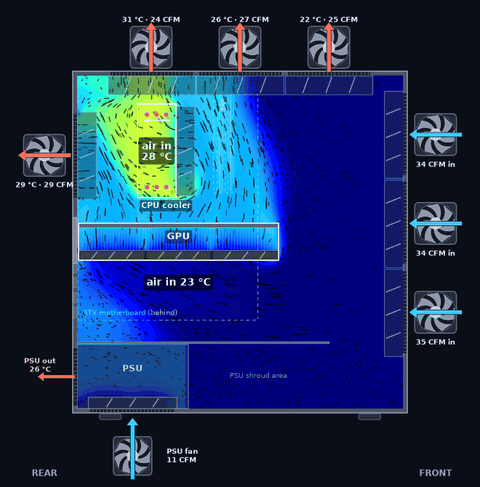
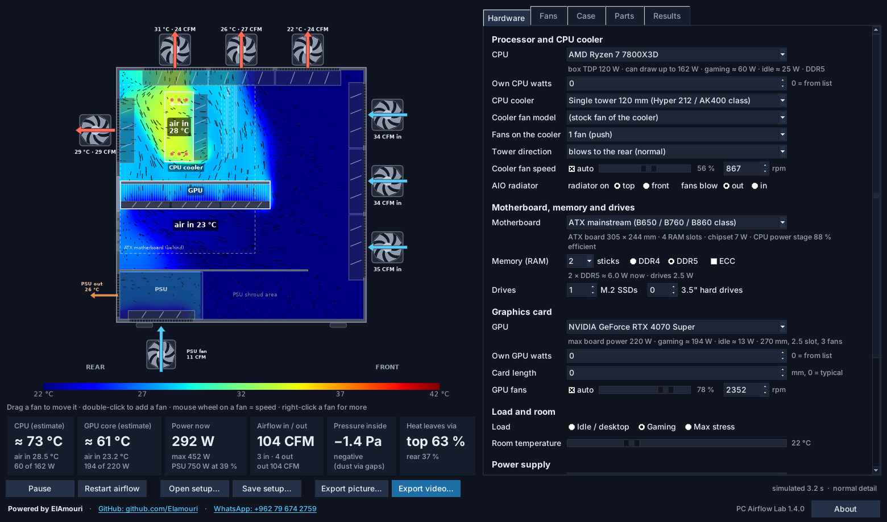
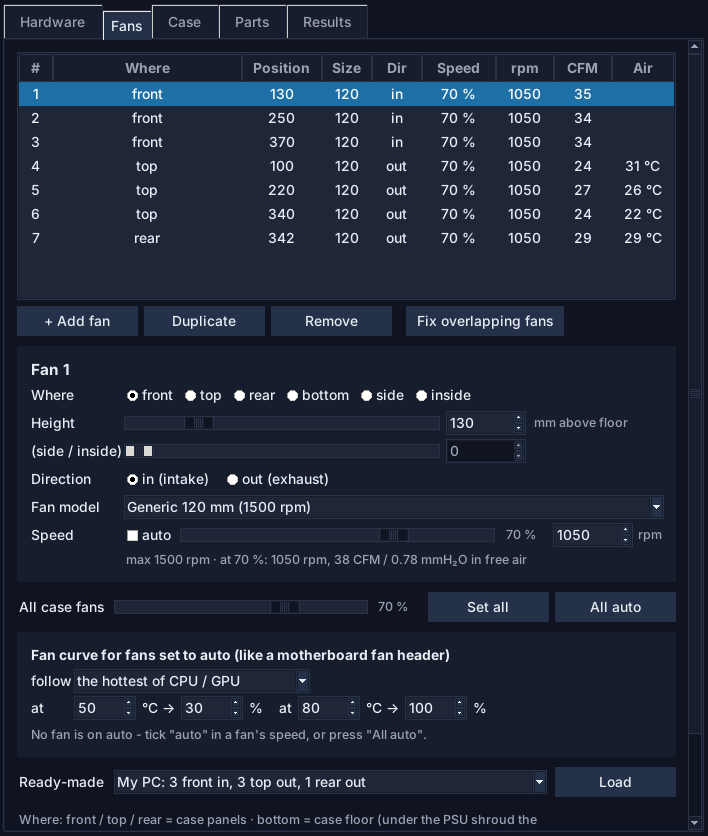
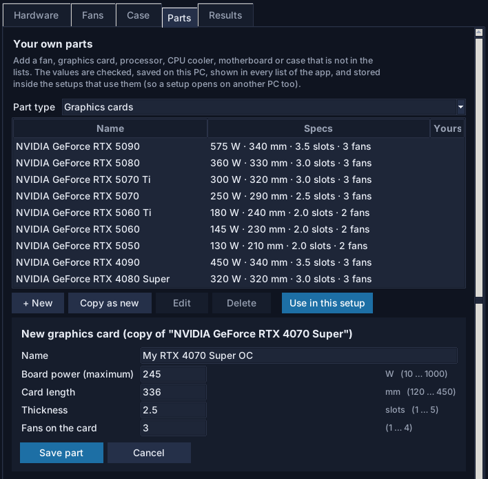
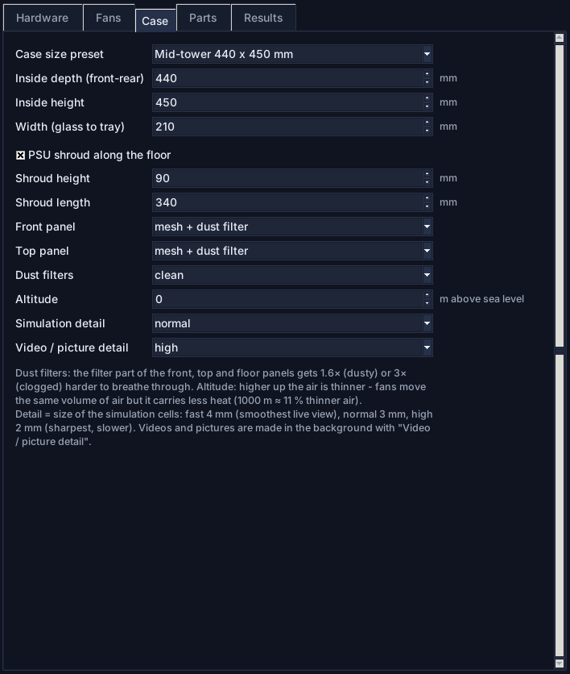
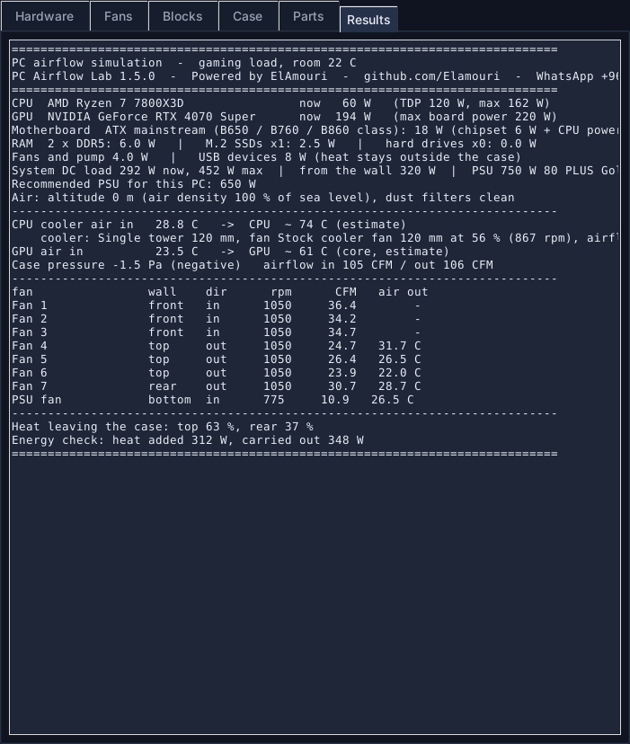
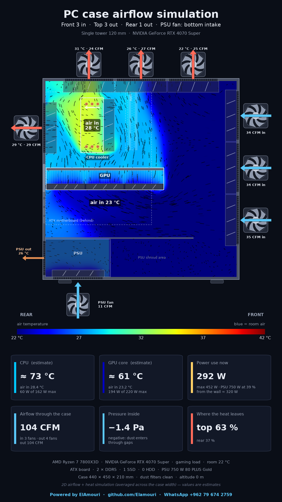
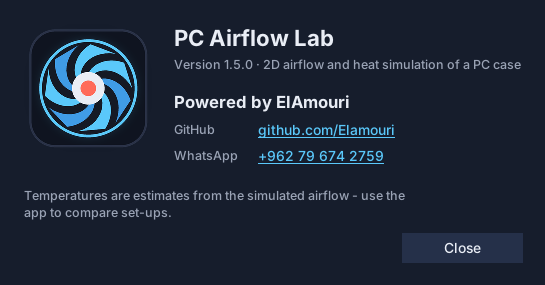

<p align="center">
  
</p>

<h1 align="center">PC Airflow Lab</h1>

<p align="center">
  <b>See how air and heat move through your PC case, and what every fan, part and setting changes.</b><br>
  A 2D airflow and heat simulation · a Windows app · Python source
</p>

<p align="center">
  <a href="https://github.com/Elamouri/PC-AirFlow-Lab-2D-/releases/latest/download/PC_Airflow_Lab.exe"></a><br>
  <sub>Windows 10 / 11 (64-bit) · version 1.4.0 · <a href="https://github.com/Elamouri/PC-AirFlow-Lab-2D-/releases/latest">release notes</a></sub>
</p>

<p align="center">
  <b>Powered by ElAmouri</b> · <a href="https://github.com/Elamouri">GitHub</a> · <a href="https://wa.me/962796742759">WhatsApp +962 79 674 2759</a>
</p>

<p align="center">
  
</p>

You choose where every fan goes, which way it blows and how fast it spins: in rpm, in %, or **auto** on a fan curve. That covers case fans, fans anywhere inside the case, the CPU cooler fans, the GPU fans and the PSU fan. You also pick the CPU, cooler, graphics card, motherboard size, RAM (DDR4 / DDR5, ECC), SSDs and hard drives, power supply, dust-filter condition and altitude. Then you watch the air move.

The app shows:

* the temperature of the air that actually reaches the **CPU cooler** and the **GPU**, and rough **CPU and GPU temperatures**
* how much **power** every part uses now and at most, and which **PSU size** is recommended
* the **airflow (CFM)** and outgoing air temperature of every fan, including the PSU fan
* the **pressure inside the case** (negative or positive) and **which fans carry the heat out**

Parts that are not in the lists can be **added in the app**: fans, graphics cards, processors, CPU coolers, motherboards and cases. New, duplicated and dragged fans always go to a free spot, never on top of another fan or part. Results can be exported as a 1080 × 1920 **video** or **picture**, sized for a phone screen.

---

## Download

**Windows 10 / 11 (64-bit):** download **[PC_Airflow_Lab.exe](https://github.com/Elamouri/PC-AirFlow-Lab-2D-/releases/latest/download/PC_Airflow_Lab.exe)** from the [latest release](https://github.com/Elamouri/PC-AirFlow-Lab-2D-/releases/latest). It is one file and needs no install and no Python.

1. Put `PC_Airflow_Lab.exe` anywhere, for example on the Desktop, and double-click it. The window takes a few seconds to open, because the program first unpacks itself.
2. The first time, Windows may say **"Windows protected your PC"**, because the program is new and not signed with a paid certificate. Click **More info → Run anyway**.

Where the program keeps things:

| What | Where |
|---|---|
| your setups | `Documents\PC Airflow Lab` (the example setups are copied there on the first start) |
| your own parts | `%APPDATA%\PC Airflow Lab\my_parts.json` (the Python version uses the same file) |
| pictures and videos | where you choose when you export |

You can also drag a setup file (`.json`) onto `PC_Airflow_Lab.exe` to open it. macOS and Linux: [run it from the source](#run-from-the-source).

## What's new in 1.4

* **The live view is much quicker.** A frame draws in about 15 ms instead of 85–100 ms, and clicks, drags and typing are answered in about 15 ms instead of about 200 ms, also while the air is still settling.
* **Speed, load and temperature changes apply at once.** They no longer rebuild the drawing or the pressure solver, so a change takes about 16 ms instead of about 250 ms. Sliders react after 0.12 s instead of 0.35–0.4 s.
* Number boxes show `130`, not `130.0`.

Earlier versions are listed in [CHANGELOG.md](CHANGELOG.md).

## Screenshots

<p align="center"></p>

<table>
  <tr>
    <td width="50%"><br><b>Fans:</b> every fan's wall, position, direction, model and speed (rpm, % or auto), plus the fan curve.</td>
    <td width="50%"><br><b>Parts:</b> add your own graphics card, fan, CPU, cooler, motherboard or case. Every value is checked.</td>
  </tr>
  <tr>
    <td width="50%"><br><b>Case:</b> size, PSU shroud, front and top panels, dust filters, altitude and simulation detail.</td>
    <td width="50%"><br><b>Results:</b> the full text report: power budget, temperatures, airflow per fan and where the heat leaves.</td>
  </tr>
</table>

<table>
  <tr>
    <td width="40%"></td>
    <td><b>Export picture / Export video</b> makes a 1080 × 1920 report for a phone screen: the airflow, the temperature scale, the six read-outs and your hardware. Every picture and video frame carries the <i>Powered by ElAmouri</i> line.<br><br></td>
  </tr>
</table>

---

## Using the app

**Left side: the live view.**

* **Colours** show the air temperature. Blue is room air; dark red is 20 °C warmer.
* **Black dashes** show which way the air moves. Longer dashes mean faster air.
* **Fan icons** sit outside the case. Blue arrows blow in, red arrows blow out. The numbers show the CFM, and exhaust fans also show the temperature of the air leaving through them.
* **"air in" labels** show the temperature of the air entering the CPU cooler and the GPU fans.
* **The tiles underneath** show the CPU / GPU estimates, power use, total airflow, the pressure inside the case and where the heat leaves.

**Mouse on the picture:**

| Do this | What happens |
|---|---|
| drag a fan | moves it. Wall fans slide along their wall; side and inside fans go anywhere. The outline turns red where the fan would sit on something; let go there and it snaps to the nearest free spot |
| double-click an empty spot | adds a fan there: near a wall it becomes a wall fan, anywhere else a fan *inside* the case |
| mouse wheel over a fan | speed +5 % / −5 % |
| right-click a fan | reverse · auto (fan curve) · full / half speed / stop · duplicate · delete |

**Right side: five tabs.**

| Tab | What you can change |
|---|---|
| **Hardware** | CPU · your own CPU watts · CPU cooler (tower 120 / dual 120 / dual 140, or a 240 / 280 / 360 AIO on top or front, blowing in or out) · cooler fan model, number of cooler fans (push, push-pull, 3 on a dual tower) and which way the tower blows · cooler fan speed · motherboard (ATX / E-ATX / Micro-ATX / Mini-ITX; board size, socket and RAM slot positions, chipset and power-stage heat) · RAM (1 / 2 / 4 sticks, DDR4 / DDR5, ECC) · M.2 SSDs and 3.5" hard drives · graphics card, your own GPU watts, card length, GPU fan speed · load (idle / gaming / max stress) · room temperature · PSU watts, 80 PLUS rating, PSU fan mode and speed. The box underneath shows the power budget, the recommended PSU size and every fan speed in rpm. |
| **Fans** | All fans with live CFM, rpm and air temperature. Select a fan to set **where it goes** (front, top, rear, bottom, side panel, or inside, blowing up / down / to the rear / to the front), its **position in mm**, **in or out**, the **fan model** and its **speed**. The **fan curve** drives every fan set to auto from the hottest of CPU / GPU (or only one of them), like a motherboard fan header. Add, duplicate or remove fans, set all fans at once, fix overlapping fans, or load a ready-made layout. |
| **Case** | Case size presets or your own inside depth, height and width · PSU shroud · front and top panel type · dust filters (clean / dusty / clogged) · altitude · simulation detail. |
| **Parts** | Your own parts: pick a type, press **+ New** or **Copy as new**, fill in the numbers and **Save part**. They appear in every list; **Use in this setup** puts the selected part into the current setup. |
| **Results** | The full text report, the same one the command line prints. |

**Bottom bar:** Pause / Play · Restart airflow · Open / Save setup · Export picture · Export video. Exports run in the background, so you can keep working.

After a change the simulation gets most of the time for about a second of simulated time while the air settles; the numbers are final once the status bar no longer says *settling…*.

**Fan positions** are measured to the centre of the fan: front and rear fans from the case floor, top and bottom fans from the rear wall, side-panel and inside fans from the rear wall plus the height above the floor. Bottom fans under the PSU shroud sit on the shroud and pull air in through the floor, like real shroud-mounted fans.

**No stacked fans.** *+ Add fan*, *Duplicate*, dragging, typing a position and changing a fan's wall all check the real parts in the case: other fans, the PSU, the GPU and its bracket, the cooler, the radiator, the drive cage and the shroud. A fan that cannot fit is drawn as a yellow dashed box with ✕, and **Fix overlapping fans** moves it to a free spot.

## Your own parts

1. In the **Parts** tab pick the part type, for example *Graphics cards*.
2. Select a similar part and press **Copy as new**, or press **+ New**.
3. Type a name and the numbers from the spec sheet, then **Save part**. If a value is out of range, the app says which one and what is allowed.
4. Press **Use in this setup**, or pick the part from the normal lists.

| Part | What you enter |
|---|---|
| Fan | size (mm), maximum rpm, airflow (CFM) and static pressure (mmH₂O) at full speed |
| Graphics card | maximum board power (W), length (mm), thickness (slots), number of fans |
| Processor | maker, memory type, box TDP, power limit (AMD PPT / Intel PL2), typical gaming and idle watts, die-to-cooler resistance, throttle temperature |
| CPU cooler | tower (fin stacks, thickness, height, fan size) or AIO (radiator fans, fan size), thermal resistance at full fan speed |
| Motherboard | size, chipset watts, CPU power-stage efficiency, ECC with Intel Core CPUs |
| Case | inside depth, height, width, PSU shroud and its size |

Your parts are saved in `my_parts.json`: on Windows in `%APPDATA%\PC Airflow Lab\`, on macOS / Linux in `~/.config/pc-airflow-lab/` (the Parts tab shows the path and has an *Open folder* button). A saved setup also carries the parts it uses, so it opens on another PC. Entries the app cannot use are never deleted from the file. The built-in lists are in `pcflow/hardware.py`.

## Setup files

Setups are plain JSON files (Save setup in the app, or by hand):

```json
{
  "case": {"depth_mm": 440, "height_mm": 450, "width_mm": 210,
           "shroud": true, "shroud_height_mm": 90, "shroud_length_mm": 340,
           "front_panel": "mesh + dust filter", "top_panel": "mesh + dust filter"},
  "fans": [
    {"wall": "front", "pos_mm": 130, "direction": "in",  "model": "Generic 120 mm (1500 rpm)", "speed_pct": 70},
    {"wall": "top",   "pos_mm": 100, "direction": "out", "model": "Generic 120 mm (1500 rpm)", "speed_pct": 70},
    {"wall": "rear",  "pos_mm": 342, "direction": "out", "model": "Generic 120 mm (1500 rpm)", "speed_pct": 70},
    {"wall": "side",  "pos_mm": 300, "pos2_mm": 300, "direction": "in", "model": "Arctic P12 PWM PST", "speed_pct": 80},
    {"wall": "inside","pos_mm": 340, "pos2_mm": 150, "direction": "up", "model": "Arctic P12 PWM PST", "rpm": 1200}
  ],
  "cpu": "AMD Ryzen 7 7800X3D", "cooler": "Single tower 120 mm (Hyper 212 / AK400 class)",
  "gpu": "NVIDIA GeForce RTX 4070 Super", "psu_watts": 750, "psu_rating": "80 PLUS Gold",
  "load": "gaming", "room_c": 22, "quality": "normal",
  "motherboard": "ATX mainstream (B650 / B760 / B860 class)",
  "ram_sticks": 2, "ram_type": "DDR5", "ram_ecc": false, "nvme_count": 1, "hdd_count": 0,
  "filter_condition": "clean", "altitude_m": 0,
  "fan_curve": {"source": "hottest", "t_lo": 50, "pct_lo": 30, "t_hi": 80, "pct_hi": 100}
}
```

* Any fan can use `"rpm"` instead of `"speed_pct"`; `-1` means *auto* (case fans follow `fan_curve`; the cooler, GPU and PSU fans follow the load, like their own fan curves).
* Inside fans blow `up`, `down`, `left` (to the rear) or `right` (to the front). `0` watts or `0` length means *take it from the built-in list*.
* Anything unknown, misspelled or out of range is replaced by a safe value, and the app lists what it changed.
* `configs/my_pc.json` is the example PC: 3 front fans in, 3 top out, 1 rear out, PSU fan from the bottom. Others: `positive_pressure.json`, `classic_2in_2out.json`, `aio_360_top.json`, `example_extra_fans_push_pull.json`.

## Command line

```
py run_cli.py configs/my_pc.json --report                 # text report
py run_cli.py configs/my_pc.json --png result.png          # picture
py run_cli.py configs/my_pc.json --video result.mp4 --seconds 20 --quality high
py run_cli.py configs/my_pc.json --report --load max       # another load without editing the file
py run_cli.py --selftest                                   # checks the physics (air in = air out, energy balance)
```

The Windows program runs the same command line: `PC_Airflow_Lab.exe --cli my_setup.json --png result.png`, `PC_Airflow_Lab.exe --selftest`, `PC_Airflow_Lab.exe --version`. It is a window program, so in a Command Prompt use `start /wait PC_Airflow_Lab.exe --selftest` to see the output before the prompt returns. `--quality` sets the cell size: `fast` 4 mm, `normal` 3 mm, `high` 2 mm.

## Run from the source

1. Install **Python 3.10 or newer** (on Windows from <https://www.python.org/downloads/>, with *Add python.exe to PATH* ticked; it includes Tkinter).
2. Download this repository (**Code → Download ZIP**) and unzip it, or `git clone https://github.com/Elamouri/PC-AirFlow-Lab-2D-.git`.
3. Windows: double-click **`start_windows.bat`**. macOS / Linux: `sh start_linux_mac.sh` (on Linux you may first need `sudo apt install python3-tk`).

By hand:

```
py -m pip install -r requirements.txt
py pc_airflow_lab.py configs\my_pc.json
```

## Build the .exe yourself

On Windows with Python 3.10 – 3.13, double-click **`tools\build_exe.bat`**. It installs the libraries and PyInstaller, then builds `dist\PC_Airflow_Lab.exe`. By hand:

```
py -m pip install -r requirements.txt pyinstaller
py -m PyInstaller --noconfirm --clean pc_airflow_lab.spec
```

On Linux, `tools/build_exe_wine.sh` does the same through Wine 11 or newer, with a Windows Python installed in the Wine prefix. `tools/make_readme_images.py` remakes `docs/images/report.png` and `demo.gif`.

## How it works, and how realistic it is

**Physics.** The app solves the equations of air flow (incompressible Navier–Stokes with buoyancy) and heat transport on a grid of 2–4 mm cells, in real units.

* **Air in equals air out exactly.** More fans in than out raises the pressure inside the case; the intake fans slow down and the exhaust fans speed up, as real fans do.
* **Each fan follows a fan curve:** its airflow drops as the pressure it pushes against rises. Fan laws scale airflow with rpm and pressure with rpm².
* **Resistances:** front mesh, dust filters, grilles, the cooler and GPU fins, the radiator and the inside of the PSU each slow the air. The GPU fins only pass air up and down, because they are seen edge-on.
* **Heat:** the CPU cooler or radiator, the GPU, the PSU (its 80 PLUS loss), the motherboard (chipset, CPU power stage, M.2 SSDs, fan motors), the RAM and the hard drives each give their power to the air passing through them. Energy is conserved, and `--selftest` checks it.
* **Dust filters** raise the filter resistance 1.6× (dusty) or 3× (clogged). **Altitude** thins the air (1000 m ≈ 11 % thinner): fans move the same volume, but it carries less heat.
* **Auto fans** read the CPU / GPU estimate every 0.3 s and change speed by at most 10 % at a time, so they settle instead of hunting.
* **Hot air rises** (buoyancy), and turbulence is modelled as extra mixing.

**Limits.** It is 2D: the view is averaged across the width of the case, from the glass to the motherboard tray. The case is sealed apart from the fan openings. The CPU and GPU temperatures are estimates (simulated air temperature at the cooler + power × thermal resistance; the CPU cooler's resistance follows the simulated airflow through its fins), so treat them as ±5–10 °C. **Use it to compare setups:** is the front-most top fan better as an intake? Where does the GPU's hot air go? Does a front 360 AIO heat up the GPU? It does not replace a thermometer.

**Why the live view is quick.** The case, the parts, the fan housings and the fixed labels are drawn once into see-through layers. Each frame then only paints the moving air, the spinning blades and the numbers, and pastes the layers in between, in the same stacking order as a normal drawing. The simulation runs in slices of about 16 ms with the window answering in between. Changes that keep the walls and parts in place reuse the pressure solver's factorisation.

## Project layout

```
pc_airflow_lab.py     start file for the window and the command line (what the .exe runs)
pc_airflow_lab.spec   PyInstaller recipe for PC_Airflow_Lab.exe
run_gui.py, run_cli.py, start_windows.bat, start_linux_mac.sh, requirements.txt
configs/              example setups (.json)
assets/               app icon
docs/                 PLAN.md (implementation plans) and images/ (this page)
tools/                build_exe.bat, build_exe_wine.sh, make_icon.py, make_readme_images.py
pcflow/
  branding.py         name, version and the Powered by ElAmouri credit
  hardware.py         parts database (GPUs, CPUs, coolers, fans, motherboards, RAM, drives, PSUs, cases)
  library.py          your own parts: checks, my_parts.json, parts stored inside setups
  placement.py        finds a free spot for new / duplicated / moved fans
  safejson.py         reads JSON files from other people safely
  config.py           setup format, load / save with checks, ready-made layouts
  layout.py           turns a setup into geometry: walls, fan openings, fins, heat sources
  solver.py           the airflow + heat simulation
  thermal.py          power budget, PSU efficiency, temperature estimates
  results.py          numbers for the read-outs and the text report
  render.py           drawing the case, the quick live frames and the video frames
  video.py            MP4 / GIF / PNG export
  gui.py              the desktop app (Tkinter)
  cli.py              command line
tests/                pytest tests
```

## Tests

```
py -m pip install pytest
py -m pytest -q
```

236 tests cover:

* **fans and parts:** fans never overlap at any detail level; the parts library; hostile setup files
* **physics:** motherboard, RAM, drives, filters, altitude and fan curves; conservation checks
* **output:** picture, video and command line; the credit line
* **the window:** the .exe start-up code; high-DPI and small screens; the quick live view (it matches a normal drawing and stays under half its time; speed changes keep the drawing; the window answers while the simulation runs)

The window tests need a screen and are skipped without one. Each version was planned in `docs/PLAN.md` and checked by code, security and silent-failure reviews; every finding has a regression test.

## Troubleshooting

* **`No module named tkinter`:** on Windows, reinstall Python with the default options; on Linux, `sudo apt install python3-tk`.
* **The simulation itself is slow on an old PC:** set *Simulation detail* to **fast** in the Case tab. The window stays responsive either way, and exports use their own *Video / picture detail*.
* **"Windows protected your PC":** click **More info → Run anyway** (new program without a paid code-signing certificate).
* **An antivirus program blocks the .exe:** one-file PyInstaller programs are sometimes flagged by mistake. Build it yourself (above) or run the Python version.
* **The .exe takes a few seconds to start:** it unpacks itself into a temporary folder every time.
* **A fan is "left out":** read the yellow notes above the view, then press **Fix overlapping fans** in the Fans tab.
* **Video saves as GIF:** `imageio-ffmpeg` is missing (`py -m pip install imageio-ffmpeg`).
* **Something went wrong:** details are in `pc_airflow_lab.log` next to `my_parts.json`.

## Credits

**Powered by ElAmouri**

* GitHub: <https://github.com/Elamouri>
* WhatsApp: [+962 79 674 2759](https://wa.me/962796742759)
